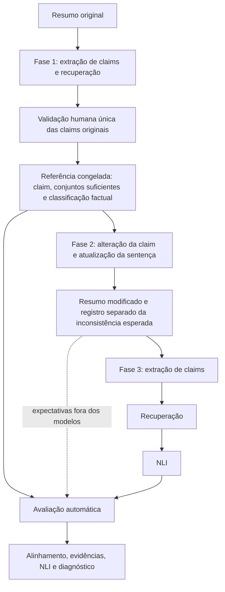

# Avaliação de consistência factual

Este projeto investiga se um sistema automático consegue verificar **se as afirmações de um resumo são sustentadas pelo documento de origem**. Ele combina revisão humana, inserção controlada de alterações e um pipeline de extração de afirmações, recuperação de evidências e inferência textual.

O objetivo é descobrir **em qual etapa uma inconsistência é detectada ou passa despercebida**:

1. A afirmação alterada foi preservada na extração?
2. O recuperador encontrou as passagens relevantes do documento?
3. O modelo factual interpretou corretamente a relação entre a afirmação e essas passagens?

O material utilizado inclui documentos e resumos em inglês do GovReport. As interfaces podem apresentar traduções para auxiliar a leitura; os textos originais continuam sendo a base das anotações e da avaliação.

## Exemplo do problema

Considere este exemplo ilustrativo:

| Elemento | Texto |
| --- | --- |
| Evidência no documento | “O processo contém cinco fases.” |
| Afirmação no resumo original | “O processo contém cinco fases.” |
| Afirmação após a alteração | “O processo contém seis fases.” |

O sistema recebe o documento e o resumo modificado. Ele precisa extrair a afirmação sobre as seis fases, recuperar a passagem sobre as cinco fases e identificar a contradição.

Se a passagem correta não for recuperada, há um problema de recuperação. Se ela for recuperada, mas a afirmação ainda for classificada como sustentada, a divergência está na decisão factual. Se a extração eliminar ou reformular a informação alterada, a análise precisa começar pela extração.

Esse diagnóstico é o motivo para avaliar cada etapa separadamente, além do resultado final.

## Conceitos usados no projeto

| Termo | Significado |
| --- | --- |
| Documento-fonte | Texto integral utilizado para verificar o resumo. |
| Resumo original | Resumo anterior às alterações. Sua origem humana não garante que todas as afirmações estejam corretas. |
| Claim | Afirmação verificável extraída do resumo. Uma sentença pode conter várias afirmações; o extrator também pode reformulá-las ou agrupá-las. |
| Evidência | Passagem do documento relevante para verificar uma afirmação. |
| Janela de contexto | Trecho que reúne sentenças vizinhas para preservar informações necessárias à interpretação. |
| Conjunto suficiente | Uma ou mais evidências que, consideradas em conjunto, permitem sustentar uma decisão factual validada. |
| Injeção | Alteração controlada de uma informação, com registro do texto anterior, do texto posterior e da posição editada. |
| NLI | Inferência textual: o modelo recebe a evidência como premissa e a claim como hipótese para avaliar a relação entre elas. |
| Referência humana ou gold | Anotação que atende aos critérios de validação do experimento. Uma proposta do gerador ou uma predição do modelo não cria gold. |

**Revisar uma sentença não equivale automaticamente a validar todas as claims que podem ser extraídas dela.** O projeto preserva essa distinção nos dados históricos e no fluxo atual.

## Arquitetura



A referência humana do original é construída na Fase 1. No fluxo integrado, o anotador também revisa as alterações propostas e confirma sua relação com as evidências antes de congelar a referência experimental. Os modelos da Fase 3 não recebem as respostas esperadas. O módulo de avaliação lê a referência e os registros de injeção somente depois da inferência.

### Fase 1 — Construir a referência humana

O ponto de partida é o resumo original. A extração produz claims e a ferramenta de revisão apresenta candidatos a evidência, com possibilidade de examinar o documento e buscar outras passagens.

O anotador confere a afirmação, julga as evidências, registra conjuntos suficientes quando aplicáveis e atribui uma decisão factual. A exportação da referência exige claim válida, revisão finalizada, documento conferido, busca concluída e evidências compatíveis com o rótulo.

O congelamento verifica textos, hashes e posições das evidências no documento. A saída contém a claim original, sua classificação humana e os conjuntos suficientes conhecidos. Ela não afirma que todas as evidências possíveis ou todas as claims de uma sentença foram identificadas.

O trabalho humano concentra-se na construção da referência sobre o original. Essa referência é preservada e reutilizada; as alterações posteriores geram expectativas que precisam de justificativa ou validação própria para serem usadas como rótulos factuais.

### Fase 2 — Inserir alterações controladas

No fluxo baseado em referência por claim, o gerador utiliza claims originalmente `SUPPORTED`, com evidências suficientes validadas. Ele modifica a claim e atualiza o trecho correspondente do resumo, preservando o vínculo com o original.

As propostas incluem alterações de predicado, entidade/quantidade e correferência, conforme a estratégia e sua aplicabilidade. Versões de tipos diferentes partem do original, permitindo comparar cada tipo sem acumular alterações de outras categorias.

A interface permite examinar as propostas, selecionar alterações e compor um resumo completo por tipo. Um resumo composto pode reunir várias alterações selecionadas em claims diferentes. A seleção exportada registra quais propostas foram escolhidas; propostas apenas geradas não são automaticamente inseridas no experimento.

Esse é o fluxo de seleção de lotes existente. Na revisão integrada, a aprovação humana inclui a relação factual da frase alterada; a materialização produz um controle original e uma alteração isolada por caso, evitando combinar edições sem validação da composição.

O importador transforma a seleção em um CSV para a Fase 3. A fonte e os resumos ficam no CSV; a proveniência das edições fica em arquivos separados. Quando há os vínculos necessários, as expectativas também são exportadas em `.injections.jsonl`. **Uma edição tecnicamente válida não comprova, por si só, que o resultado contradiz a fonte.**

### Fase 3 — Executar o sistema avaliado

O pipeline recebe o documento-fonte e os resumos completos. Ele reextrai suas próprias claims, sem usar as claims humanas, as evidências anotadas ou os rótulos esperados como pistas.

| Etapa | O que faz | Resultado |
| --- | --- | --- |
| Extração | Identifica afirmações no resumo original e nas versões modificadas. | Claims com texto, contexto e identificadores. |
| Recuperação | Combina rankings semânticos e BM25 por RRF e reordena os candidatos com cross-encoder. As consultas podem incluir contexto e entidades. | Sentenças e janelas de contexto com posições, ranks e scores. |
| NLI | Avalia a relação entre a claim e as evidências recuperadas, aplicando a agregação e os limiares configurados. | Decisão factual, escores, passagem e motivo da decisão. |

As decisões finais são:

| Decisão | Interpretação |
| --- | --- |
| `SUPPORTED` | O procedimento encontrou suporte suficiente segundo suas regras e limiares. |
| `CONTRADICTED` | O procedimento encontrou evidência de contradição segundo suas regras e limiares. |
| `NOT_SUPPORTED` | O procedimento não estabeleceu suporte nem contradição suficientes. Isso pode refletir insuficiência de evidência, recuperação ou ambiguidade. |

`NOT_SUPPORTED` não significa que a afirmação seja falsa. Da mesma forma, um `SUPPORTED` automático pode divergir da referência humana.

O comando recomendado termina em NLI. Taxonomia e comparação com a referência pertencem ao módulo separado de avaliação.

### Avaliação automática — Comparar e diagnosticar

Depois da inferência, o comparador usa a referência para examinar alinhamento de claims, recuperação das evidências e decisões NLI.

O comparador canônico usa texto exato com normalização de espaços e composição exata de proposições, preservando a caixa das entidades. A confirmação semântica é opcional e exige mais que similaridade de embeddings. Claims reformuladas ou divididas podem ficar sem correspondência; duplicatas e previsões compartilhadas podem gerar ambiguidade. Esses casos não são declarados erros factuais automaticamente. Consulte o [protocolo integrado de alinhamento](docs/integrated-validation.md#comparação-e-condições-e0e3).

Para a recuperação, verifica se as passagens contêm todos os membros de pelo menos um conjunto suficiente conhecido. Uma janela pode conter várias evidências: seu ID de âncora não representa sozinho o conjunto todo. A ausência de um conjunto conhecido também não demonstra que outras evidências recuperadas sejam inválidas.

Nas claims alteradas, a expectativa do gerador permanece separada de um rótulo humano ou derivado por protocolo validado. O comparador não transforma essa expectativa em acurácia NLI. Ele produz `diagnostics.jsonl`, `unaligned_predictions.jsonl` e `report.json`.

## Modelos e configuração

O baseline da Fase 3 está definido em [configs/baseline.yaml](configs/baseline.yaml):

| Componente | Modelo ou método |
| --- | --- |
| Segmentação e análise linguística | spaCy `en_core_web_sm`. |
| Extração de claims | `Babelscape/t5-base-summarization-claim-extractor`. |
| Recuperação semântica | `all-mpnet-base-v2`. |
| Fusão dos rankings | Reciprocal Rank Fusion (RRF), com `k = 60`, sobre rankings semânticos e BM25. |
| Sinais auxiliares | Consultas com contexto/entidades; sobreposição lexical e entidades para o sinal de qualidade usado pelo NLI. |
| Reordenação dos candidatos | `cross-encoder/ms-marco-MiniLM-L-6-v2`. |
| Inferência NLI | `MoritzLaurer/DeBERTa-v3-large-mnli-fever-anli-ling-wanli`. |
| Tradução de apoio à leitura | `qwen3.5:9b` no Ollama local; não participa da decisão factual. |

A configuração padrão recupera oito sentenças e quatro janelas por claim. A constante RRF (`retrieval.rrf_k`), os tamanhos dos pools, limiares e revisões dos checkpoints ficam no YAML. A ferramenta de referência humana tem seu próprio recuperador, configurado em [configs/reference.yaml](configs/reference.yaml); seus resultados não devem ser confundidos com a recuperação da Fase 3.

Há também uma variante de extração enriquecida em [configs/enriched_claims.yaml](configs/enriched_claims.yaml). Mudar modelos, variantes ou limiares define outra condição experimental e deve ser registrado em uma nova execução.

### Como a Fase 3 usa RRF

O recuperador aplica a mesma fórmula a sentenças e janelas de contexto, separadamente:

$$
RRF(d) = \sum_{r \in R} \frac{1}{k + r(d)}
$$

- **d:** candidato a evidência.
- **R:** listas retornadas pelos canais semântico e BM25 para cada consulta distinta (literal, contextual, de entidades ou variante de correferência).
- **r(d):** posição do candidato na lista, começando em 1; ausência na lista contribui zero.
- **k:** constante positiva, padrão 60; não é o número de evidências retornadas.

Consultas iguais após normalização não recebem votos duplicados. Os pools continuam com até 30 candidatos semânticos e 30 lexicais por consulta. A união inteira é ordenada pelo RRF e encaminhada ao cross-encoder, sem um novo corte intermediário. O cross-encoder determina a ordem final; em empate, prevalecem o RRF e depois a posição no documento.

Os candidatos exportados registram `fusion_method`, `rrf_score`, `rrf_k` e `rrf_ranks`, além dos canais de origem. **`rrf_score` é o valor bruto da fórmula.** O campo `retrieval_score` mantém a combinação anterior de similaridade semântica, sobreposição lexical e entidades como sinal de qualidade consumido pelo NLI; seus pesos não ordenam mais os candidatos. Isso evita substituir esse sinal por um RRF de escala diferente sem recalibrar o decisor factual.

A alteração define uma nova condição de recuperação. Os resultados anteriores continuam sendo históricos e não foram recalculados. Os testes verificam a fórmula, os canais, empates e integração com modelos simulados; não demonstram ganho de qualidade no conjunto real. RRF também já é utilizado na preparação da referência humana, com configuração e recuperador próprios.

## Pastas

```text
fase1_referencia/           Comandos e dados da construção da referência
fase2_injecao/              Comandos do gerador controlado, seleção e lotes provisórios
fase3_pipeline/             Comandos do pipeline avaliado e entradas em CSV
avaliacao_automatica/       Alinhamento, comparação e diagnóstico
src/factual_eval/
  fase1_referencia/         Implementação da referência, interface e congelamento
  fase2_injecao/            Gerador integrado e importação dos resumos
  fase3_pipeline/           Extração, recuperação e NLI
  avaliacao_automatica/     Comparação independente e taxonomia legada
  config.py, schemas.py…   Infraestrutura compartilhada
configs/, tests/, docs/    Configurações, testes e documentação
outputs/                   Novos resultados separados por fase
historico/avaliador/       Cópia dos resultados anteriores, sem reescrever manifestos
scripts/                   Entradas antigas preservadas por compatibilidade
```

## Por onde continuar

Para revisar afirmações, evidências e alterações na mesma sessão, use o [guia da validação integrada](docs/integrated-validation.md). A interface apresenta uma afirmação por vez e organiza o trabalho em quatro passos:

1. **Afirmação:** confira se a extração representa a frase do resumo; corrija ou acrescente informações omitidas.
2. **Evidências:** escolha trechos do documento, salve os conjuntos suficientes e registre a relação factual.
3. **Inconsistências:** o sistema analisa entidade, predicado e correferência na sentença, explica os tipos que não se aplicam ou não puderam ser avaliados e propõe apenas alterações candidatas. Confira e aprove ou recuse cada proposta.
4. **Finalizar:** resolva as pendências, salve a referência final e prepare a avaliação automática.

A aba **Visão geral** mostra o progresso. As decisões são salvas no arquivo de anotações; seleções de evidência ainda não confirmadas ficam como rascunho e impedem a finalização. Códigos, pontuações e opções avançadas ficam em detalhes expansíveis.

### Abrir a revisão integrada já preparada nesta máquina

Com o ambiente `nlp_mestrado` ativado, execute:

```bash
python fase1_referencia/serve_review.py \
  --html outputs/fase1_referencia/revisao-integrada-traduzida-qwen35-20261112/review-html/avaliacao.html \
  --source fase1_referencia/dados/govreport_source.jsonl \
  --annotations outputs/fase1_referencia/revisao-integrada/anotacoes.json \
  --port 8773
```

Abra [http://127.0.0.1:8773/integrated](http://127.0.0.1:8773/integrated). Se o serviço já estiver em execução, basta abrir o endereço. O HTML e as anotações desse exemplo são artefatos locais, ausentes em um clone novo; para prepará-los em outra máquina, siga o [guia integrado](docs/integrated-validation.md#como-iniciar).

### Português e inglês na interface

O português e o inglês aparecem em blocos separados, identificados por idioma. A tradução é um auxílio de leitura; o inglês continua como entrada científica e texto editável das afirmações.

A execução local traduziu 517 textos com o **Qwen 3.5 9B do Ollama**, usando temperatura zero e instruções para preservar orações, números, nomes, negações e grau de certeza. Foram feitas passagens adicionais de revisão e retradução de casos críticos. Ainda há 112 textos com alertas heurísticos para conferência; a tradução não foi validada integralmente por humanos. Consulte os comandos e a proveniência no [guia de tradução integrada](docs/integrated-validation.md#tradução-para-leitura).

| Etapa | Guia | Principal saída |
| --- | --- | --- |
| Fase 1 | [Construção da referência](fase1_referencia/README.md) | `reference_claims.jsonl`, `sources.jsonl`, hashes e conjuntos suficientes |
| Fase 2 | [Injeção controlada](fase2_injecao/README.md) | Propostas vinculadas à claim humana, resumos compostos e expectativas separadas |
| Fase 3 | [Pipeline avaliado](fase3_pipeline/README.md) | Claims reextraídas, evidências e decisões NLI |
| Avaliação | [Comparação e diagnóstico](avaliacao_automatica/README.md) | Diagnósticos de alinhamento, evidência e NLI |

## Começar pelo lote já disponível

Execute os comandos na raiz do projeto. Os dados deste lote são locais e não são versionados: um clone novo pode não conter os arquivos de propostas, seleção e entrada mencionados abaixo.

### 1. Ativar o ambiente

Nesta máquina, o ambiente existente do avaliador é:

```bash
cd ~/avaliacao-consistencia-factual
conda activate nlp_mestrado
```

Para uma instalação separada, consulte as dependências declaradas em [pyproject.toml](pyproject.toml) e o [guia de instalação](docs/usage.md#instalação). O ambiente observado utiliza Python 3.10, PyTorch 2.5.1, Transformers 4.38.2 e Sentence Transformers 2.7.0. Os modelos spaCy precisam ser instalados separadamente; os checkpoints são carregados na execução das etapas.

O gerador com correferência pode precisar do extra `controlled` e de um ambiente próprio. O visualizador e o importador de seleção não precisam executar os modelos.

### 2. Abrir a visualização da Fase 2

```bash
python fase2_injecao/visualizar_selecao.py \
  --input fase2_injecao/provisorios/claim_versions_v62.jsonl \
  --serve --port 8772
```

Abra [http://127.0.0.1:8772](http://127.0.0.1:8772) no navegador e mantenha o terminal aberto. Para restaurar a seleção existente, use **Importar seleção** e escolha o JSON em `fase2_injecao/selecoes/selecao_inconsistencias.json`. Depois de escolher as propostas, use **Exportar seleção (.json)** para registrar a nova seleção.

O lote existente contém 30 propostas. A seleção exportada utilizada no teste contém seis alterações: cinco de entidade e uma de predicado. A entrada resultante contém um documento e três versões: original, entidade e predicado. Isso não significa seis documentos nem seis resumos modificados.

### 3. Converter uma seleção em entrada para o pipeline

Use um destino novo para cada importação:

```bash
python fase2_injecao/import_selected_summaries.py \
  --selection fase2_injecao/selecoes/selecao_inconsistencias.json \
  --proposals fase2_injecao/provisorios/claim_versions_v62.jsonl \
  --source fase1_referencia/dados/govreport_source.jsonl \
  --output fase3_pipeline/entradas/minha-selecao.csv
```

O importador confere a seleção contra o hash do lote de propostas e reconstrói as alterações sobre o resumo original. O CSV já preparado para o lote atual está em `fase3_pipeline/entradas/selecao_v63_20261111.csv`.

### 4. Executar a Fase 3

Para usar a entrada já preparada:

```bash
python fase3_pipeline/run_pipeline.py \
  --input fase3_pipeline/entradas/selecao_v63_20261111.csv \
  --all-docs \
  --device cuda:0
```

Para avaliar uma seleção nova, troque `--input` pelo CSV criado na etapa anterior. `--device auto` seleciona CUDA quando disponível e CPU nos demais casos; `--device cpu` permite execução explícita em CPU, que pode ser demorada.

O comando imprime a pasta da execução e o caminho de saída. `--all-docs` processa todos os documentos da entrada; sem essa opção, a seleção padrão da configuração pode limitar a quantidade de documentos. Cada documento pode produzir várias versões e muitas claims.

### 5. Consultar os resultados

Cada execução cria uma pasta própria dentro de `outputs/fase3_pipeline/`:

| Arquivo dentro da execução | Como utilizar |
| --- | --- |
| `claims/claims.parquet` | Conferir se a informação original ou alterada sobreviveu à extração. |
| `retrieval/retrieval.parquet` | Inspecionar as sentenças e janelas recuperadas por claim. |
| `nli/nli.parquet` | Ler a decisão, os escores, a passagem utilizada e o motivo. |
| `claims/stage_counts.json`, `retrieval/stage_counts.json`, `nli/stage_counts.json` | Consultar contagens de entrada e saída por etapa. |
| `config.resolved.yaml` | Recuperar a configuração efetivamente utilizada. |
| `manifest.json` | Conferir estado da execução, hashes, versões e proveniência. |
| `execution.log` | Acompanhar progresso e investigar falhas. |

Os Parquets podem ser lidos com `pandas.read_parquet`. Para conferir as contagens NLI pelo terminal, substitua `EXECUCAO` pelo nome impresso pelo comando:

```bash
python -m json.tool outputs/fase3_pipeline/EXECUCAO/nli/stage_counts.json
```

Os comandos de execução criam diretórios exclusivos. Para repetir um experimento, use um novo `--run-id` ou deixe o nome ser gerado automaticamente. Uma execução com falha deve ser preservada para diagnóstico.

## Executar o fluxo com referência por claim

O lote acima permite explorar o sistema existente. Para um experimento baseado em referência congelada por claim, siga esta sequência:

1. Extraia as claims apenas dos resumos originais e prepare a interface de anotação.
2. Revise as claims, as evidências e as decisões factuais; exporte a referência e congele-a com o snapshot da fonte.
3. Gere propostas a partir dessa referência, selecione as alterações e exporte os resumos para CSV.
4. Execute a Fase 3 sobre o CSV, mantendo os rótulos e as evidências humanas fora das entradas dos modelos.
5. Compare a saída com a referência congelada no módulo de avaliação automática.

Os comandos detalhados estão nos guias da [Fase 1](fase1_referencia/README.md), [Fase 2](fase2_injecao/README.md) e [avaliação automática](avaliacao_automatica/README.md). Exemplo da última etapa:

```bash
python avaliacao_automatica/comparar_referencia.py \
  --reference outputs/fase1_referencia/referencia-001/reference_claims.jsonl \
  --nli outputs/fase3_pipeline/EXECUCAO/nli/nli.parquet \
  --retrieval outputs/fase3_pipeline/EXECUCAO/retrieval/retrieval.parquet \
  --output outputs/avaliacao_automatica/comparacao-001
```

Quando houver registros de injeção vinculados à referência, acrescente `--injections` com o arquivo correspondente. Os caminhos são exemplos e precisam apontar para os artefatos reais do mesmo experimento.

## Estado e limites explícitos

A separação entre as fases, o importador de seleção e a execução de extração, recuperação e NLI estão implementados. Uma execução local com modelos reais já processou o lote de três versões, produzindo 69 claims. A comparação local ampliada examinou os 16 itens da revisão sentencial e as seis alterações selecionadas; os relatórios ficam em `outputs/avaliacao_automatica/` e não integram o Git.

Essa execução não equivale à conclusão do experimento científico com referência congelada por claim. Os dados antigos de revisão por sentença permanecem identificados como tal. Ao interpretar os resultados:

- Uma anotação de apoio a uma sentença não valida automaticamente cada claim extraída dela.
- A escolha de uma proposta não cria um rótulo factual pós-injeção validado.
- Extração e segmentação podem mudar o texto e a quantidade de claims, dificultando o alinhamento.
- Recuperar evidências corretas não garante uma decisão NLI correta.
- A ausência de uma passagem anotada não comprova ausência de suporte em todo o documento.
- O campo legado `gabarito_injetado` e as matrizes antigas baseadas no gerador não são referência humana. No lote importado sem marcadores, `none` também não significa verdade factual.
- Resultados de um lote local não permitem generalizar a qualidade do sistema para toda a coleção.

O estado dos componentes é:

- Referência: validação humana original, conjuntos suficientes e offsets verificados; sem inferir cobertura exaustiva da sentença.
- Injeção: alterações registradas na claim e na sentença, com vínculo à referência original. O tipo e a relação esperados não são gold factual automático.
- Pipeline: termina em NLI; geração, referência humana e taxonomia ficam fora do caminho canônico da Fase 3.
- Avaliação automática inicial: alinhamento textual exato com abstenção em ambiguidades/paráfrases, verificação de conjuntos conhecidos e comparação NLI válida somente quando existe rótulo de referência aplicável. Alinhamento semântico robusto e derivação factual pós-injeção continuam no [backlog](BACKLOG_ARQUITETURA.md).

Os projetos de origem foram preservados. [MIGRACAO_FASES.json](MIGRACAO_FASES.json) registra a origem, os hashes e os destinos dos arquivos copiados. A reorganização não reexecutou os modelos; as execuções posteriores ficam registradas separadamente. Dados pessoais, anotações, caches e resultados locais permanecem fora do Git conforme [.gitignore](.gitignore).

## Compatibilidade e testes

Os imports públicos antigos apontam para as implementações canônicas; os antigos comandos em [scripts/](scripts/) continuam disponíveis. O comando antigo [scripts/run_pipeline.py](scripts/run_pipeline.py) ainda permite o fluxo histórico com geração/taxonomia. O comando recomendado [fase3_pipeline/run_pipeline.py](fase3_pipeline/run_pipeline.py) restringe a execução à extração, recuperação e NLI.

Com as dependências instaladas, execute os testes rápidos:

```bash
python -B -m unittest discover -s tests -v
```

Os testes rápidos usam fixtures e modelos simulados; não demonstram, sozinhos, equivalência de inferência neural ou qualidade factual. As integrações reais são opcionais e estão descritas no [guia de testes de integração](tests/integration/README.md).

## Documentação adicional

| Para saber mais | Guia |
| --- | --- |
| Instalação, execução e reutilização de intermediários | [Guia de uso](docs/usage.md) |
| Anotação humana e critérios de conclusão | [Interface de auditoria](docs/audit-interface.md) |
| Salvamento, histórico e recuperação das revisões | [Salvamento das anotações](docs/review-autosave.md) |
| Tradução de apoio à leitura | [Auditoria bilíngue](docs/bilingual-audit.md) |
| Contratos, IDs e formatos dos intermediários | [Contratos do pipeline](docs/pipeline.md) |
| Fronteiras científicas e interpretação das decisões | [Metodologia](docs/methodology.md) |
| Experimentos planejados e referências necessárias | [Catálogo de experimentos](docs/experiments.md) |
| Demais documentos e histórico | [Índice da documentação](docs/README.md) |

A documentação anterior foi preservada em [docs/history/README_antes_das_fases.md](docs/history/README_antes_das_fases.md). Não altere as versões científicas dos modelos ao trocar de pasta.

O projeto incorpora componentes de terceiros. Consulte [LICENSE](LICENSE) e [THIRD_PARTY_NOTICES.md](THIRD_PARTY_NOTICES.md) antes de redistribuir ou reutilizar esses componentes.
